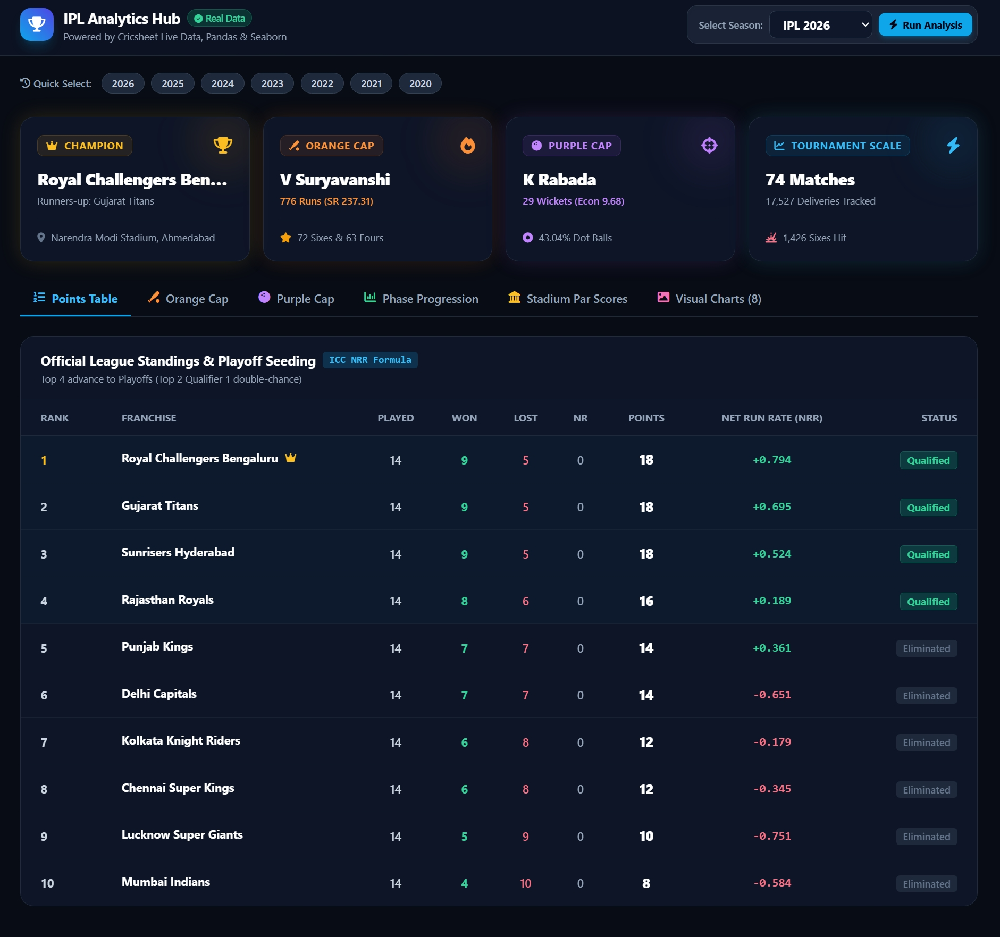
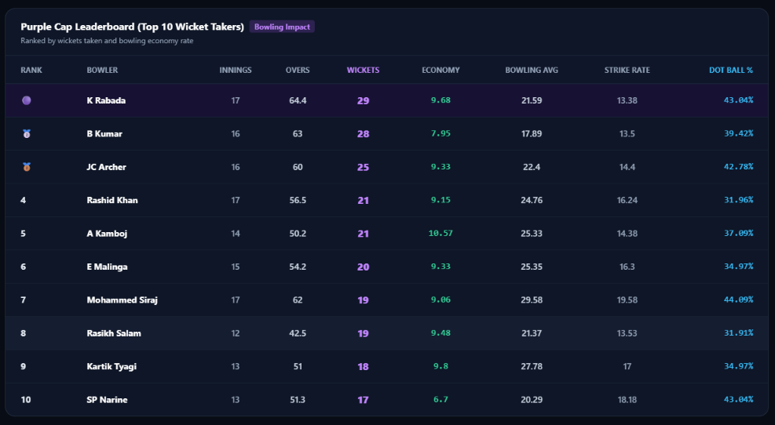
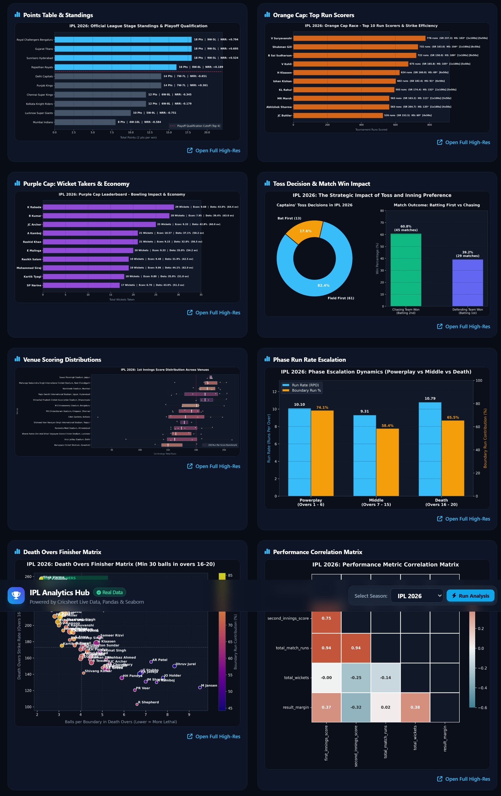
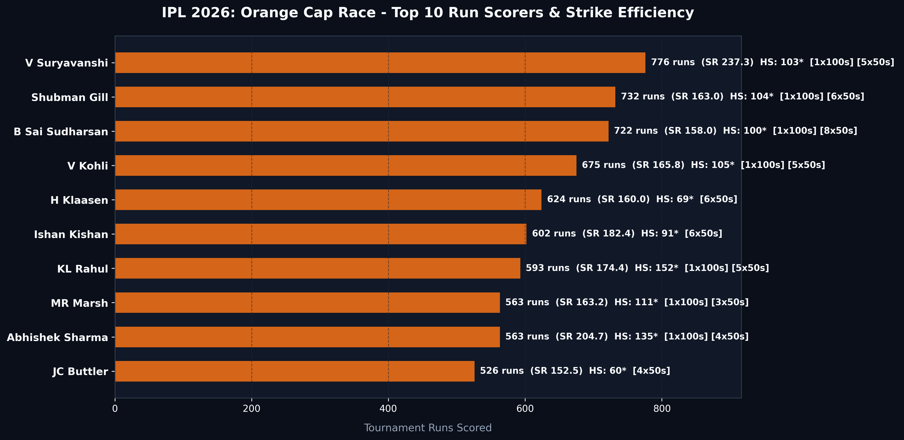
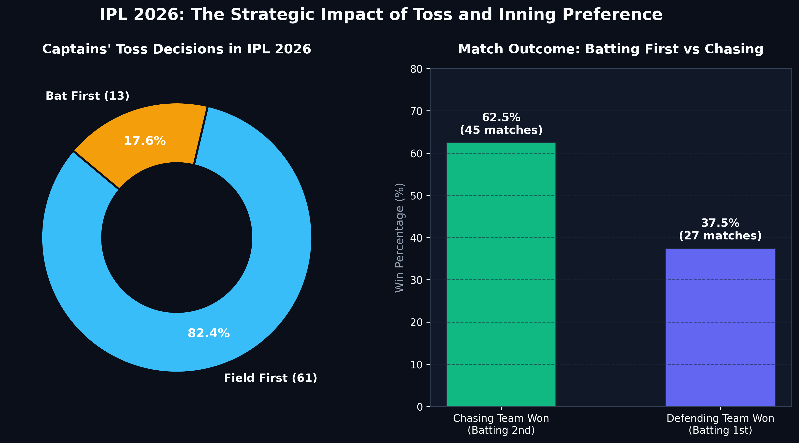

# 🏏 IPL Analytics Hub

An interactive **Flask web dashboard** for exploring Indian Premier League seasons (2008 – 2026). Pick a season and the app downloads the official ball-by-ball data from [Cricsheet](https://cricsheet.org), computes the statistics with Pandas, renders charts with Matplotlib/Seaborn, and shows everything in a dark, responsive UI.


## Features

- **Season selector** – switch between any IPL season with quick pills or a dropdown
- **Points table** – wins, losses, points and Net Run Rate (NRR) computed from ball-by-ball data
- **Orange Cap / Purple Cap** – top run scorers and wicket takers with strike rate, average, economy, dot-ball %
- **Phase analysis** – Powerplay vs Middle vs Death overs run rates and boundary share
- **Death-over finishers** – strike rate and balls per boundary in overs 16–20
- **Venue profiles** – average 1st/2nd innings scores, chase win %, sixes per match
- **Chart gallery** – 8 auto-generated charts per season (toss impact, correlation heatmap, etc.)
- Results are cached in memory, so revisiting a season is instant

## Screenshots

### 1. Full Dashboard


### 2. Purple Cap Table


### 3. Charts Gallery


### 4. Orange Cap


### 5. Toss Impact

## Project structure

```
ipl-analytics-hub/
├── app.py                  # Flask app and JSON API
├── templates/
│   └── index.html          # Dashboard UI (Tailwind CSS via CDN)
├── src/
│   ├── cricsheet_loader.py # Downloads and parses Cricsheet data
│   ├── metrics.py          # NRR, batting, bowling, phase, venue calculations
│   └── visualizer.py       # Chart generation
├── data/raw/               # Season CSVs, created automatically (git-ignored)
├── figures/                # Charts, created automatically (git-ignored)
├── docs/screenshots/       # README images
└── requirements.txt
```

## Getting started

```bash
git clone https://github.com/<your-username>/<your-repo>.git
cd <your-repo>

python -m venv .venv
# Windows: .venv\Scripts\activate
source .venv/bin/activate

pip install -r requirements.txt
python app.py
```

Open **http://127.0.0.1:5000**. The first time you open a season, the app downloads the Cricsheet archive (~7 MB, internet required) and caches it under `data/raw/`.

### Configuration (optional environment variables)

| Variable | Default | Purpose |
|---|---|---|
| `PORT` | `5000` | Port to listen on |
| `HOST` | `127.0.0.1` | Set to `0.0.0.0` to make it reachable from other devices on your network |

## API

| Endpoint | Description |
|---|---|
| `GET /` | Dashboard |
| `GET /api/season/<season>` | Full analytics for a season as JSON (a plain year, e.g. `2026` or `2020`) |
| `GET /figures/<year>/<file>` | Generated chart image |

> Seasons are always plain calendar years. Cricsheet's own labels (`2007/08` = IPL 2008, `2009/10` = IPL 2010, `2020/21` = IPL 2020) are translated internally, so no slash-named folders or files are created.

## Data source & attribution

Match data comes from [Cricsheet](https://cricsheet.org) and is used under its [license terms](https://cricsheet.org/register/) (CC BY-SA 4.0). It is downloaded at runtime and is not redistributed in this repository. This project is not affiliated with the BCCI or the IPL.

## Tech stack

Python · Flask · Pandas · NumPy · Matplotlib · Seaborn · Tailwind CSS
